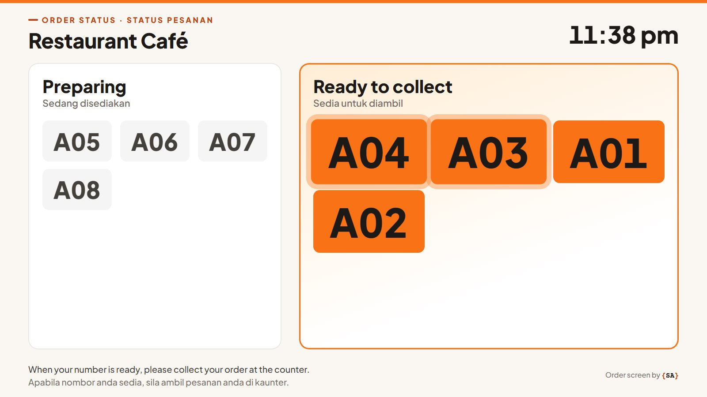
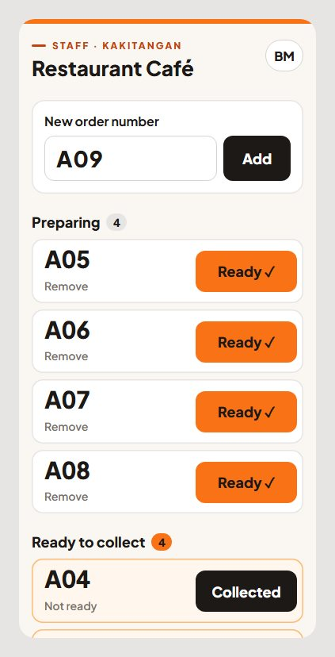
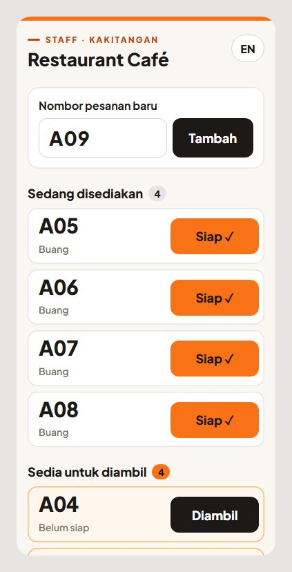
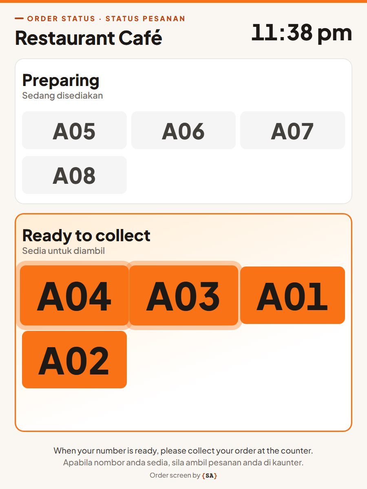
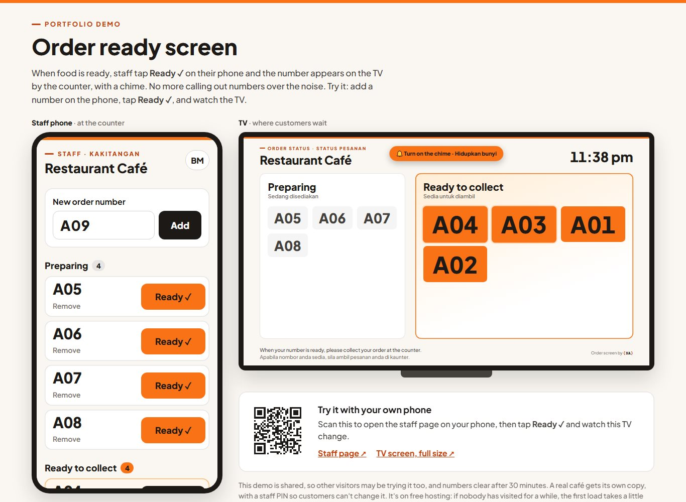

# Order ready screen

A screen for the TV by a café's counter. When food is ready, staff tap **Ready ✓** on their
phone, and the order's number appears on the TV with a chime. No more shouting numbers over
the noise, and customers can sit down instead of crowding the counter.

**▶ Live demo: coming soon** (it'll show the staff phone and the TV side by side, live). It's on free
hosting, so if nobody has visited for a while the first load takes a little longer.

| The TV by the counter | The staff phone | In Bahasa Malaysia |
|---|---|---|
|  |  |  |

## What it does

| | |
|---|---|
| **Two pages, one list** | The staff page on any phone, the TV screen on any TV or tablet with a browser. A tap on the phone shows on the TV within two seconds. |
| **Easy to see from across the room** | Big numbers, "Ready" in orange, the newest one pops in and glows for 30 seconds, and a soft ding-dong. English and BM together, because nobody can tap a TV to switch language. |
| **Quick at a busy counter** | The next number is already typed in, so a new order is one tap. Ready, then Collected. Several staff phones can work at once. |
| **Forgiving** | Undo after Collected or Remove, Not ready if Ready was tapped too soon, and it won't add the same number twice. |
| **Staff only** | A staff PIN, typed once on each phone, so customers on the café's Wi-Fi can't change the screen. |
| **English and BM** | The staff page switches with one button, and phones set to Malay start in BM. |
| **Any screen** | It fills a TV lying down or a tablet standing up, in a light or a dark look. It says so if the Wi-Fi drops, and carries on when it's back. |

| A tablet standing up | The portfolio demo |
|---|---|
|  |  |

## The interesting problems

**A phone and a TV that have never met.** They're two separate devices, so they need something
in between that both can reach: a small server that keeps the list of orders. The phone sends
it each tap; the TV asks it for the list every two seconds. Asking every two seconds is simpler
than keeping a live connection open, and it works through any café Wi-Fi.

**No database, on purpose.** An order only matters for a few minutes, so the list lives in the
server's memory. If the server restarts overnight, it starts the day with an empty screen,
which is what a café wants anyway. That's also why the server runs as one single process: two
would each keep their own list.

**Locking out customers without locking out staff.** A 4-digit PIN can be guessed, so wrong
guesses are limited. But in a café, every phone on the Wi-Fi shares one internet address: limit
that address and one customer playing with the PIN locks out all the staff. So a phone that
types the right PIN gets a long secret "staff key" back, and uses that for every tap from then
on. Only typing the PIN is limited, and phones already set up keep working.

**Browsers don't let pages make sound on their own.** That stops adverts from blaring, but it
also stops the chime. So the TV shows a "Turn on the chime" button until someone taps it once,
when the TV is switched on in the morning. The chime itself is made by the browser, so there's
no sound file to download.

**A glow that kept restarting.** The first version redrew every number on the TV every few
seconds, which made the newest one "pop" in again each time. Now the TV only adds and removes
the numbers that changed, and leaves the rest alone.

## Built with

Python and [Flask](https://flask.palletsprojects.com/) for the small server, and plain HTML, CSS
and JavaScript for the two pages. The demo's QR code uses
[qrcode-generator](https://github.com/kazuhikoarase/qrcode-generator) (MIT licence). Hosted on Render.

## How I built it

I'm not a trained programmer. This is one of a set of small projects I'm making to start
working as a freelancer, and to show café and restaurant owners what I can make for them.

I built it with an AI coding assistant (Claude Code), which wrote the code. My part was
deciding what the café needs, checking every screen, and asking for changes when something
wasn't right, like a lighter screen, and BM that sounds natural.

---

# Setting it up for a café

## Files

| File | What it is |
|---|---|
| `public/settings.js` | The café's name, the TV's look (light or dark) and the note at the bottom of the TV. **The only file to change for another café.** |
| `public/screen.html`, `screen.css`, `screen.js` | The TV screen (at `/tv`) |
| `public/staff.html`, `staff.css`, `staff.js` | The staff page (at `/staff`) |
| `public/orders.js` | How both pages talk to the server |
| `public/demo.html`, `qrcode.js` | The portfolio demo (only shown when `DEMO` is on) |
| `app.py` | The server: keeps the orders, checks the staff PIN |
| `requirements.txt` | What the server needs installed |
| `docs/screenshots/` | The pictures in this README |

## Server settings

These go in the server's settings (on Render: **Environment**), never in the code.

| Setting | What it does |
|---|---|
| `STAFF_PIN` | The PIN staff type once on each phone. Use 6 digits. Change it if someone leaves, and every phone has to type the new one. |
| `SECRET_KEY` | A long random text, so phones stay logged in when the server restarts. On Render, press **Generate**. |
| `DEMO` | `1` for the portfolio demo: no PIN, the side-by-side page at `/`, and numbers clear after 30 minutes. Leave it out for a real café. |

## Trying it on your own computer

```
python -m venv .venv
.venv\Scripts\python -m pip install flask
.venv\Scripts\python app.py
```

Then open http://localhost:5050/staff and http://localhost:5050/tv. With no `STAFF_PIN` set, no PIN is asked.

## Putting it online (Render)

**New → Web Service**, pick this repository, then:

| | |
|---|---|
| Build Command | `pip install -r requirements.txt` |
| Start Command | `gunicorn app:app --workers 1 --threads 8 --bind 0.0.0.0:$PORT` |
| Environment | `STAFF_PIN` and `SECRET_KEY` (see above) |

Keep `--workers 1`: the orders live in the server's memory, and two workers would each keep their own list.

## In the café

- **The TV:** open `/tv` in the TV's browser (or on a tablet, or a laptop plugged into the TV), make it full screen, and tap **Turn on the chime** once. Set the TV not to go to sleep.
- **The phones:** open `/staff`, type the PIN once, and add the page to the home screen so it opens like an app.
- **Order numbers:** use the numbers on the receipts, or let the page count up (A01, A02…).

---

Order screen by **{SA}** · [github.com/Lady-Pickle](https://github.com/Lady-Pickle)
